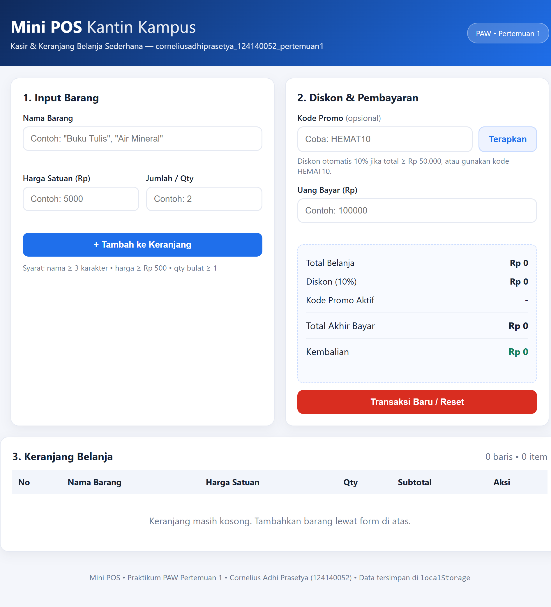
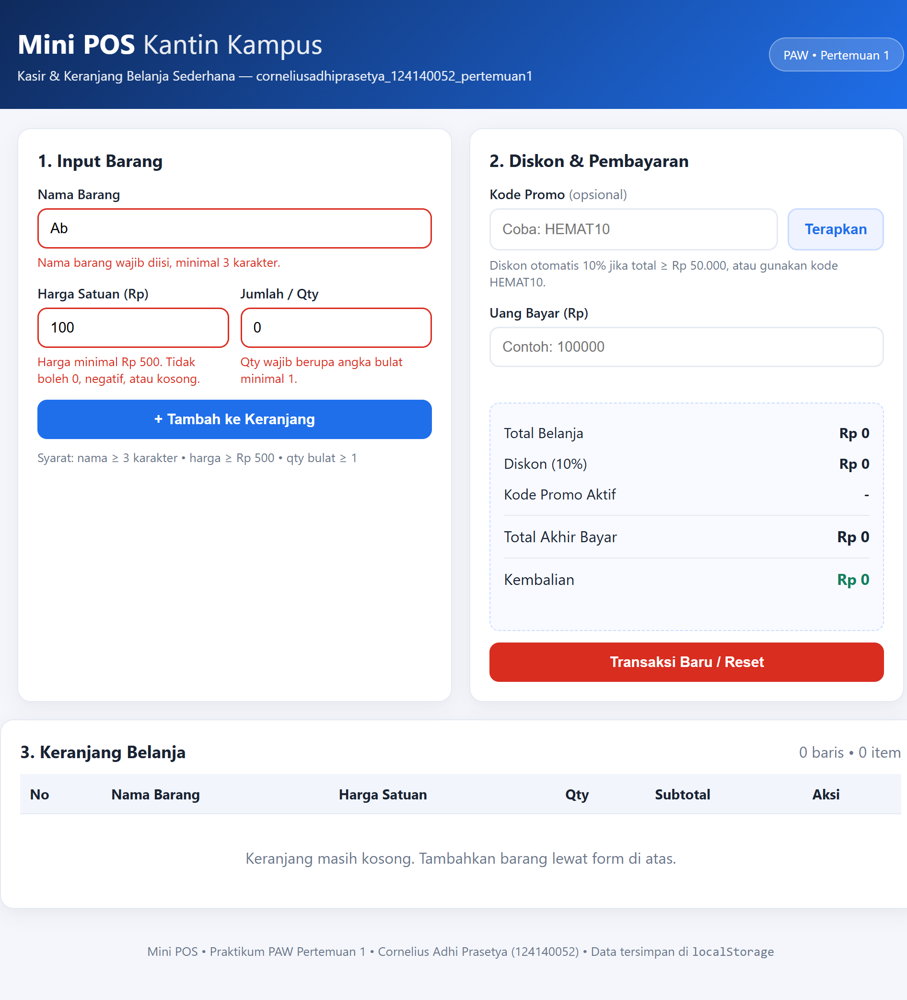
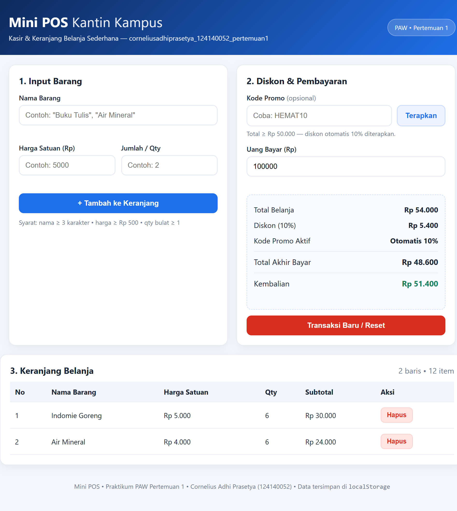

# Mini POS — Kasir & Keranjang Belanja Sederhana

## 1. Identitas
- **Nama Lengkap:** Cornelius Adhi Prasetya
- **NIM:** 124140052
- **Kelas Praktikum:** Praktikum PAW Pertemuan 1
- **Folder:** `corneliusadhiprasetya_124140052_pertemuan1`

## 2. Deskripsi Aplikasi
Aplikasi web **Mini POS (Point of Sale)** untuk kasir kantin / toko kampus.

Tujuan pembuatan:
- Melatih 3 kompetensi dasar praktikum dalam satu alur utuh: validasi input form, perhitungan kalkulator otomatis, dan manajemen keranjang berbasis `localStorage`.
- Memberikan alur kasir yang jelas: input barang → masuk keranjang → total & diskon otomatis → input uang bayar → hitung kembalian → reset transaksi.

Studi kasus yang dipilih:
- Kasir menginput **Nama Barang, Harga Satuan, Qty**.
- Sistem menghitung **Subtotal = Harga × Qty** per baris.
- Sistem menjumlahkan **Total Belanja** otomatis.
- Diskon **10%** jika total ≥ Rp 50.000 **atau** kode promo `HEMAT10` dipakai.
- Kasir menginput **Uang Bayar**, sistem menghitung **Kembalian = Uang Bayar − Total Akhir**.
- Keranjang tersimpan persisten di `localStorage` sehingga tidak hilang saat refresh.

## 3. Struktur Folder
```
corneliusadhiprasetya_124140052_pertemuan1/
├── index.html
├── style.css
├── script.js
├── README.md
└── modul/
    ├── latihan-validasi.html
    ├── latihan-kalkulator.html
    └── latihan-localstorage.html
```

## 4. Panduan Menjalankan
1. Clone repo:
   ```bash
   git clone https://github.com/wisercornelius/pemrograman_web_itera_124140052.git
   ```
2. Buka folder:
   ```
   pemrograman_web_itera_124140052/corneliusadhiprasetya_124140052_pertemuan1/
   ```
3. Jalankan di browser lokal — pilih salah satu:
   - **Cara termudah (tanpa server):** klik dua kali `index.html` → terbuka di browser.
   - **Cara disarankan (Live Server VS Code):**
     1. Buka folder di VS Code.
     2. Install extension **Live Server** (Ritwick Dey).
     3. Klik kanan `index.html` → **Open with Live Server**.
     4. Browser membuka `http://127.0.0.1:5500/.../index.html`.
4. Tidak ada build / dependency. Cukup browser modern (Chrome/Edge/Firefox).

## 5. Daftar Fitur
- [x] Validasi **Nama Barang**: wajib, minimal 3 karakter. Pesan merah di bawah input, cegah masuk keranjang.
- [x] Validasi **Harga Satuan**: wajib angka positif, minimal Rp 500. Tolak 0 / negatif / kosong.
- [x] Validasi **Qty**: wajib angka bulat minimal 1.
- [x] Form otomatis **reset** setelah barang berhasil ditambahkan.
- [x] **Subtotal otomatis** per baris: `Harga × Qty`.
- [x] **Total Belanja** otomatis (jumlah seluruh subtotal).
- [x] **Diskon 10%** otomatis jika total ≥ Rp 50.000.
- [x] **Kode promo `HEMAT10`** — diskon 10% walau total < Rp 50.000.
- [x] Tampil **nominal diskon** dan **total akhir bayar**.
- [x] **Kalkulator kembalian**: `Kembalian = Uang Bayar − Total Akhir`. Peringatan jika uang kurang.
- [x] **Tabel keranjang**: kolom No, Nama, Harga, Qty, Subtotal, Aksi.
- [x] **Hapus item** per baris + hitung ulang total/diskon otomatis.
- [x] **LocalStorage**: `JSON.stringify()` saat simpan, `JSON.parse()` saat muat. Key: `miniPosCart_124140052`.
- [x] **Transaksi Baru / Reset**: kosongkan keranjang + bersihkan `localStorage`.

## 6. Tangkapan Layar (Screenshot)
> Simpan screenshot di folder yang sama / subfolder `screenshots/` lalu sesuaikan path di bawah.

1. **Form input utama + tabel kosong:**
   
2. **Validasi error muncul (pesan merah):**
   
3. **Hasil kalkulator + tabel riwayat (diskon & kembalian):**
   
   > Contoh pada screenshot: `Indomie Goreng 5000 × 6` + `Air Mineral 4000 × 6`
   > = total Rp 54.000, diskon otomatis 10% Rp 5.400, total akhir Rp 48.600,
   > uang bayar Rp 100.000, kembalian Rp 51.400.

Cara mengambil screenshot:
1. Jalankan via Live Server.
2. Screenshot 1: saat halaman baru dibuka.
3. Screenshot 2: isi nama `Ab`, harga `100`, qty `0` lalu klik Tambah → pesan merah muncul.
4. Screenshot 3: tambahkan mis. `Indomie Goreng – 5000 × 6` + `Air Mineral – 4000 × 6` (total ≥ 50rb, diskon muncul), isi Uang Bayar `100000`.

## 7. Penjelasan Teknis Singkat
Alur logika utama ada di `script.js`:

1. **State & persistensi:**
   - `cart = loadCart()` saat start — baca `localStorage.getItem(STORAGE_KEY)` lalu `JSON.parse()`.
   - Setiap mutasi (tambah/hapus/reset) → `saveCart()` = `localStorage.setItem(KEY, JSON.stringify(cart))` lalu `render()`.
   - Reset memakai `localStorage.removeItem(KEY)`.

2. **Validasi input (`validateInput()`):**
   - Nama: `trim().length >= 3`.
   - Harga: `Number(harga) >= 500`, tolak `NaN` / kosong / negatif.
   - Qty: `Number.isInteger(qty) && qty >= 1`.
   - Jika gagal: isi `<small class="error">` + class `invalid` (border merah), `return false` sehingga `submit` dibatalkan. Jika sukses: `push` ke cart, `form.reset()`.

3. **Kalkulator keuangan:**
   - Subtotal per baris: `item.harga * item.qty`.
   - Total: `cart.reduce((sum, it) => sum + it.harga*it.qty, 0)`.
   - Diskon: `hitungDiskon(total)` → `total*0.1` jika `total >= 50000 || promoAktif`, else `0`.
   - Total akhir: `total - diskon`.
   - Kembalian: `uangBayar - totalAkhir`. Jika `< 0` → tampilkan "Uang belum mencukupi. Kurang Rp X". Jika keranjang kosong → kembalian Rp 0.

4. **Render (`render()`):**
   - Render ulang `<tbody>` setiap state berubah, update Total/Diskon/Total Akhir/Kembalian, update info promo, toggle pesan kosong, format angka via `Intl.NumberFormat('id-ID')`.
   - Hapus item via event delegation: tombol `.btn-hapus` dengan `data-index`, lalu `splice()` + simpan + render ulang.

## 8. Modul Latihan (`modul/`)
- `latihan-validasi.html` — latihan cek minimal 3 karakter.
- `latihan-kalkulator.html` — latihan subtotal & diskon 10%.
- `latihan-localstorage.html` — latihan `stringify` / `parse` / `removeItem`.
