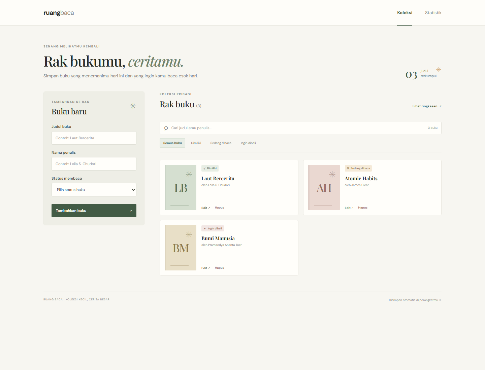
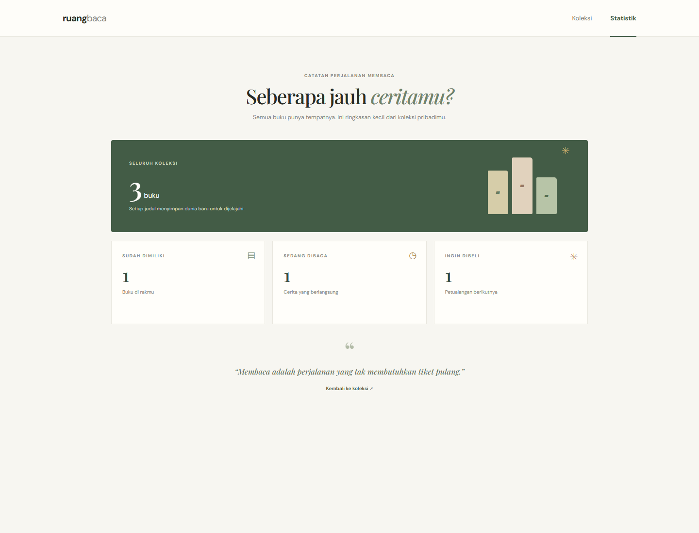
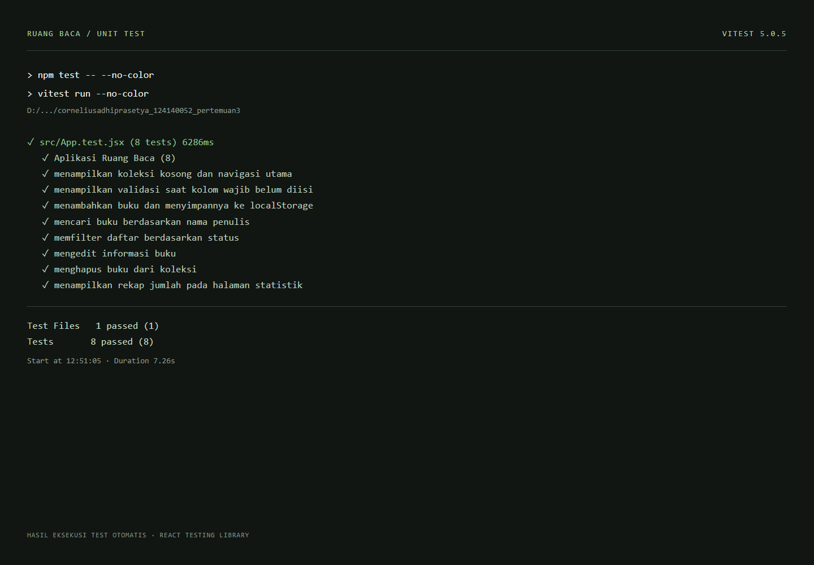

# Ruang Baca — Manajemen Buku Pribadi

Project tugas Praktikum Pemrograman Web ITERA, Pertemuan 3.

**Nama:** Cornelius Adhi Prasetya  
**NIM:** 124140052

Ruang Baca adalah aplikasi untuk mencatat buku yang sudah dimiliki, sedang dibaca, atau ingin dibeli. Data disimpan otomatis pada `localStorage` browser, jadi koleksi tetap tersedia setelah halaman dimuat ulang.

## Fitur

- Tambah, edit, dan hapus catatan buku.
- Status buku: **Sudah dimiliki**, **Sedang dibaca**, atau **Ingin dibeli**.
- Pencarian berdasarkan judul maupun nama penulis.
- Filter koleksi berdasarkan status.
- Halaman Statistik dengan ringkasan jumlah buku per status.
- Validasi kolom wajib beserta pesan dan penanda visual pada input.
- Penyimpanan otomatis di browser melalui `localStorage`.
- Tampilan responsif untuk desktop dan layar ponsel.

## Menjalankan di VS Code

Pastikan Node.js dan npm sudah terpasang. Buka folder project ini di VS Code, kemudian jalankan perintah berikut di terminal terintegrasi:

```bash
npm install
npm run dev
```

Buka URL lokal yang ditampilkan Vite (biasanya `http://localhost:5173`). Untuk menjalankan unit test:

```bash
npm test
```

Untuk membuat build produksi dan melihatnya secara lokal:

```bash
npm run build
npm run preview
```

## Screenshot aplikasi dan laporan test

Screenshot antarmuka menggunakan contoh data dan laporan hasil test tersimpan di folder [`screenshots/`](./screenshots/).

### Halaman koleksi



### Halaman statistik



### Hasil unit test



Laporan test menampilkan output aktual dari `npm test -- --no-color` dengan format terminal agar mudah dibaca.

## Teknologi dan konsep React

- **React functional components dan Hooks:** `useState`/`useEffect` untuk form dan lifecycle, serta `useMemo` untuk hasil filter dan statistik.
- **Context API:** `BookProvider` menjadi sumber state buku untuk seluruh halaman; `useBooks` menyediakan operasi tambah, ubah, dan hapus.
- **React Router:** navigasi multi-halaman antara Koleksi (`/`) dan Statistik (`/statistik`).
- **Custom hooks:** `useLocalStorage` untuk persistensi dan `useBookStats` untuk menghitung jumlah buku berdasarkan status.
- **PropTypes:** pemeriksaan tipe props pada komponen, page, dan provider.
- **Testing:** Vitest, jsdom, dan React Testing Library.

## Struktur project

```text
src/
├── components/
│   ├── BookCard.jsx
│   ├── BookFilters.jsx
│   ├── BookForm.jsx
│   ├── BookList.jsx
│   └── Header.jsx
├── context/BookContext.jsx
├── hooks/
│   ├── useBookStats.js
│   └── useLocalStorage.js
├── pages/
│   ├── Home.jsx
│   ├── NotFound.jsx
│   └── Stats.jsx
├── test/setup.js
├── App.jsx
├── App.test.jsx
├── main.jsx
└── styles.css
```

## Pengujian

Test mencakup tampilan awal, validasi input, tambah dan persistensi buku, pencarian penulis, filter status, edit, hapus, dan ringkasan statistik. Jalankan seluruh test dengan `npm test`.

`node_modules/`, `dist/`, dan `coverage/` sudah diabaikan melalui `.gitignore`; jangan unggah folder dependensi ke Git.
