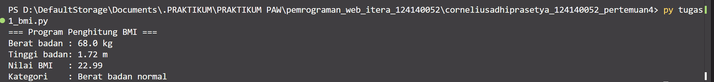
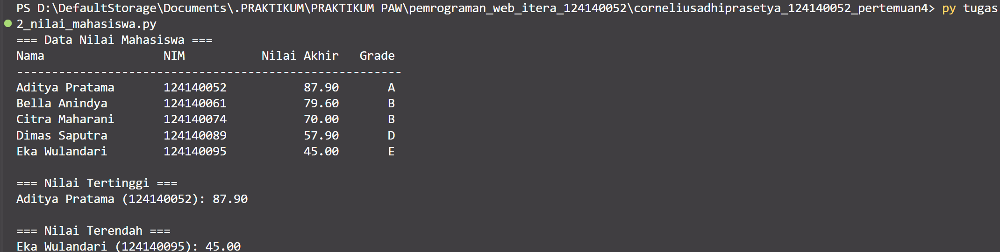
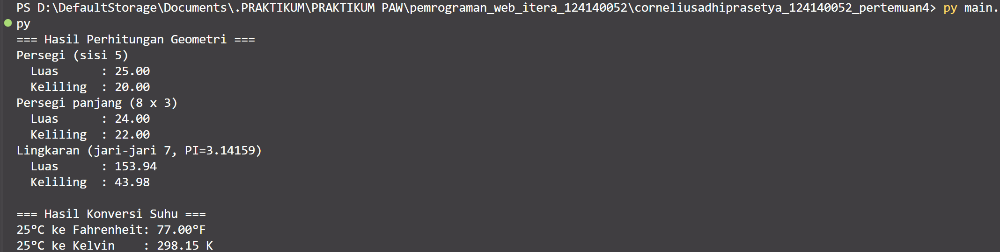

# Praktikum Dasar Pemrograman Python — Pertemuan 4

## Identitas

- **Nama:** Cornelius Adhi Prasetya
- **NIM:** 124140052

## Deskripsi Program

1. **`tugas1_bmi.py`** menghitung BMI dari contoh berat 68 kg dan tinggi 1,72 m, kemudian menentukan kategori berat badan dengan percabangan `if-elif-else`.
2. **`tugas2_nilai_mahasiswa.py`** menyimpan data lima mahasiswa dalam list of dictionaries, menghitung nilai akhir berbobot dan grade, menampilkan tabel, serta mencari nilai tertinggi dan terendah.
3. **`math_operations.py`** menyediakan fungsi luas dan keliling persegi, persegi panjang, dan lingkaran, serta fungsi konversi Celsius ke Fahrenheit dan Kelvin. Konstanta `PI` digunakan dalam perhitungan lingkaran.
4. **`main.py`** mengimpor modul dengan dua cara (`import math_operations` dan `from math_operations import ...`) dan menampilkan contoh hasil seluruh fungsi modul.

Seluruh program menggunakan data contoh yang ditentukan di dalam skrip, sehingga bisa langsung dijalankan.

## Cara Menjalankan

Buka terminal pada direktori folder ini, lalu jalankan:

```powershell
py tugas1_bmi.py
py tugas2_nilai_mahasiswa.py
py main.py
```

Pastikan Python 3 sudah terpasang. File `math_operations.py` harus berada di direktori yang sama dengan `main.py`.

## Hasil Eksekusi

Berikut output yang diperoleh saat ketiga program dijalankan.

### Soal 1 — Penghitung BMI

```text
=== Program Penghitung BMI ===
Berat badan : 68.0 kg
Tinggi badan: 1.72 m
Nilai BMI   : 22.99
Kategori    : Berat badan normal
```

### Soal 2 — Nilai Mahasiswa

```text
=== Data Nilai Mahasiswa ===
Nama                 NIM           Nilai Akhir   Grade
-------------------------------------------------------
Aditya Pratama       124140052           87.90       A
Bella Anindya        124140061           79.60       B
Citra Maharani       124140074           70.00       B
Dimas Saputra        124140089           57.90       D
Eka Wulandari        124140095           45.00       E

=== Nilai Tertinggi ===
Aditya Pratama (124140052): 87.90

=== Nilai Terendah ===
Eka Wulandari (124140095): 45.00
```

### Soal 3 — Modul Matematika

```text
=== Hasil Perhitungan Geometri ===
Persegi (sisi 5)
  Luas      : 25.00
  Keliling  : 20.00
Persegi panjang (8 x 3)
  Luas      : 24.00
  Keliling  : 22.00
Lingkaran (jari-jari 7, PI=3.14159)
  Luas      : 153.94
  Keliling  : 43.98

=== Hasil Konversi Suhu ===
25°C ke Fahrenheit: 77.00°F
25°C ke Kelvin    : 298.15 K
```

## Gambar Hasil Eksekusi

Gambar berikut menampilkan output program dalam tampilan terminal. Gambar dibuat berdasarkan hasil eksekusi skrip, bukan tangkapan layar desktop secara langsung.

### Soal 1 — Penghitung BMI



### Soal 2 — Nilai Mahasiswa



### Soal 3 — Modul Matematika


