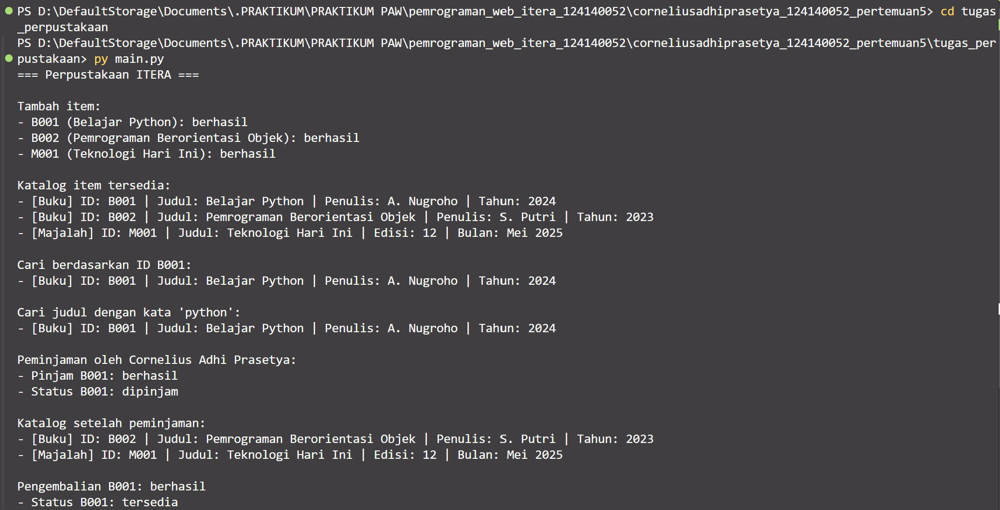

# Sistem Manajemen Perpustakaan Sederhana

## Identitas Mahasiswa

- **Nama:** Cornelius Adhi Prasetya
- **NIM:** 124140052
- **Kelas Praktikum:** RA

## Deskripsi Program

Program utama berada pada `tugas_perpustakaan/`. `main.py` membuat koleksi berisi buku dan majalah, menampilkan katalog yang tersedia, mencari item dengan ID atau kata pada judul, lalu menunjukkan perubahan status saat sebuah buku dipinjam dan dikembalikan.

### Penerapan Empat Pilar OOP

- **Class dan object:** `LibraryItem`, `Book`, `Magazine`, `Library`, dan `Member` menjadi cetak biru untuk objek pada sistem.
- **Inheritance:** `Book` dan `Magazine` mewarisi `LibraryItem`; keduanya mengimplementasikan method abstrak `get_detail()`.
- **Encapsulation:** ID dan judul item serta koleksi perpustakaan dilindungi dengan atribut private (`__item_id`, `__title`, `__koleksi`). Status peminjaman menggunakan atribut protected (`_is_borrowed`). Akses status/identitas disediakan melalui property.
- **Polymorphism:** katalog memanggil `get_detail()` pada semua item. Setiap subclass menghasilkan detail sesuai jenis itemnya.
- **Abstract class:** `LibraryItem` mewarisi `ABC` dan menetapkan `get_detail()` sebagai method abstract.

Class `Member` mendemonstrasikan peminjaman/pengembalian dan menyimpan daftar ID item secara private. Operasi yang tersedia termasuk menambah item, menampilkan item tersedia, mencari item berdasarkan ID atau judul, meminjam, serta mengembalikan item.

Folder `latihan/` berisi contoh mandiri untuk object, procedural vs OOP, class/object, inheritance, encapsulation, polymorphism, dan abstract class.

## Struktur Berkas

```text
corneliusadhiprasetya_124140052_pertemuan5/
├── latihan/
│   ├── 01_everything_is_object.py
│   ├── 01_procedural_vs_oop.py
│   ├── 02_class_object.py
│   ├── 03_inheritance.py
│   ├── 04_encapsulation.py
│   ├── 05_polymorphism.py
│   └── 06_abstract_class.py
├── tugas_perpustakaan/
│   ├── library_item.py
│   ├── member.py
│   ├── library.py
│   └── main.py
├── screenshots/
├── README.md
└── .gitignore
```

## Cara Menjalankan

Pastikan Python 3 terpasang. Dari folder utama proyek, jalankan program perpustakaan:

```powershell
cd tugas_perpustakaan
py main.py
```

Untuk menjalankan contoh latihan, kembali ke folder utama dan jalankan, misalnya:

```powershell
py latihan/06_abstract_class.py
```

Semua contoh latihan dapat dijalankan dengan cara yang sama menggunakan nama berkas masing-masing.

## Hasil Eksekusi Program Utama

Program telah dijalankan dan berhasil mendemonstrasikan penambahan tiga item, katalog, pencarian, peminjaman, serta pengembalian. Gambar berikut merupakan visualisasi output terminal dari hasil eksekusi, bukan tangkapan layar desktop secara langsung.


